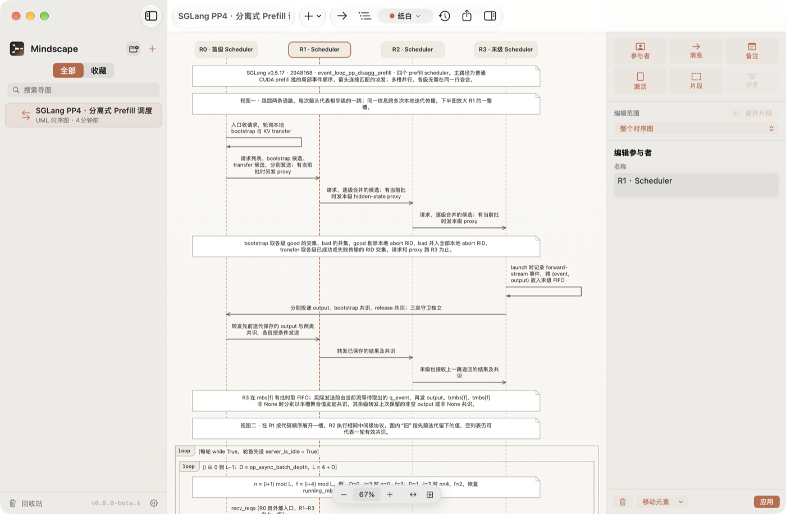

# SGLang PP4 分离式 Prefill 调度

在支持 UML 时序图的 Mindscape 中选择“导入”，打开本目录的 JSON 即可继续编辑。在 PDF 中放大可以逐条核对箭头与守卫。[可编辑文档](sglang-pp4.json) · [矢量时序图](sglang-pp4.pdf)

图分为两个视角。上半部分跟随消息穿过四个 scheduler，区分正向请求、候选和 proxy，以及从末级环回的 output 和两类共识。下半部分沿 R1 的生命线展开一次槽迭代。两段描述同一个循环，不代表先后执行的两个阶段。

图中的 D 是异步批深度，环长为 4+D。版本固定为 v0.5.17，主路径为 CUDA，图内说明 XPU 上 output 收发顺序的差异。参照入口和接收器见官方源码。[调度循环和通信辅助函数](https://github.com/sgl-project/sglang/blob/29481685462732237d80d86076d6563e1f658102/python/sglang/srt/managers/scheduler_pp_mixin.py#L178-L359) · [请求接收器](https://github.com/sgl-project/sglang/blob/29481685462732237d80d86076d6563e1f658102/python/sglang/srt/managers/scheduler_components/request_receiver.py)

## 在画布上重画

1. 在侧栏的“+”菜单选择“UML 时序图”。添加四位参与者，将显示名称分别填写为 R0、R1、R2、R3。
2. 添加消息时点选发送方和接收方，在属性面板选择异步箭头并填写消息文字。R3 发送到 R0 就是环回，同一条生命线作为两端则形成自调用。
3. 用跨生命线备注说明当前视图、槽位公式和共识规则。添加 loop 片段后，在该片段内继续添加消息、备注或 opt。使用“离开片段”返回外层，再添加其下一个同级事件。
4. 点选图元修改其属性，用文档主题选择器切换外观。保存后可以再次打开，也可以导出整张图为矢量 PDF。

下图为实际编辑器中点选 R1 后的状态。右侧可修改名称，工具栏提供连线、主题和大纲。

